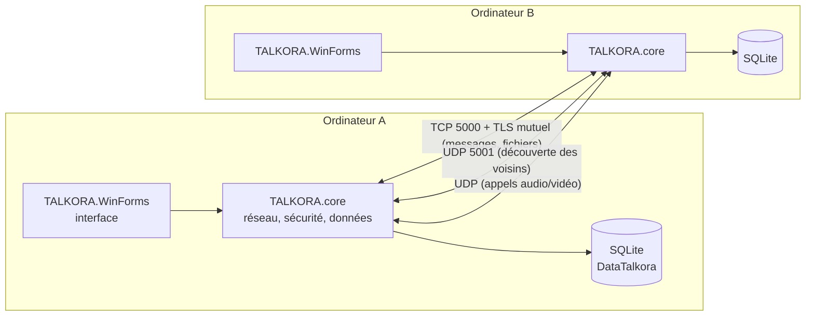

# Talkora

**Talkora** est une messagerie de bureau inspirée de WhatsApp Desktop, écrite en **C# (WinForms, .NET 10)**.
Elle fonctionne **en réseau local, en pair à pair (P2P), sans serveur central et sans Internet**.

> Projet de groupe — Bachelor 2, KEYCE Informatique & Intelligence Artificielle.

## Pourquoi Talkora ?
- **P2P** : chaque ordinateur parle directement aux autres. Aucun serveur ne peut lire ou perdre les messages.
- **Hors ligne par défaut** : tout reste sur l'ordinateur. Un mode « En ligne » (Claude) est facultatif.
- **Simple comme WhatsApp** : on entre son nom, les ordinateurs du réseau se trouvent tout seuls.
- **Sécurisé** : TLS mutuel, identités vérifiées (TOFU), intégrité des fichiers (SHA-256), PIN, Windows Hello.

## Fonctionnalités
| Domaine | Contenu |
|---|---|
| Messagerie | texte, accusés de réception, réponses, suppression (pour moi / pour tous), épinglage, recherche, messages temporaires, sondages, groupes (admins, annonces, invitation avec accord) |
| Branches | discussion par sujet à partir d'un message, rangeable en dossiers |
| Fichiers & médias | envoi de fichiers avec contrôle d'intégrité, vocaux, photo/vidéo par webcam, stickers |
| Appels | audio/vidéo en UDP |
| Réseau | TCP 5000 (TLS mutuel), découverte automatique UDP 5001, contacts bloqués |
| Statuts & vie sociale | statuts, avatars, souvenirs, suivis (rappels), Together (listes partagées) |
| IA locale (Tali) | suggestions, correction, traduction, résumé |
| Émotion | ambiances et « vague » de fond selon l'humeur des messages |
| Voix | dictée, transcription, résumé et tâches d'un vocal |
| Sécurité | tableau de bord, journal, score de confiance, PIN, empreinte/visage (Windows Hello), signalement |
| Confidentialité | photo de profil visible par tous ou par moi seul, invitation par e-mail |
| Sync | continuer sur plusieurs appareils du même réseau |
| Atelier | espace de code partageable, livre de l'informatique, agenda des grands informaticiens |
| Mode En ligne (option) | Claude : complétion, réponses automatiques par contact |

## Architecture

Deux projets principaux :
- `TALKORA.core` : logique (réseau, chiffrement, stockage SQLite, IA, sécurité). Sans interface.
- `TALKORAforms` (`TALKORA.WinForms`) : interface Windows Forms, thème bordeaux & argent.

## Installation et lancement
Prérequis : Windows 10/11, Visual Studio 2022+ avec la charge de travail **Développement .NET Desktop**, SDK .NET 10.

1. Cloner : `git clone <URL-du-dépôt>`
2. Ouvrir `TALKORA/TALKORA.slnx` dans Visual Studio.
3. Projet de démarrage : **TALKORA.WinForms**.
4. F5. Au premier lancement : pseudo, langue, PIN facultatif.
5. Pare-feu Windows : autoriser Talkora sur le **réseau privé** (TCP 5000, UDP 5001).
6. Lancer Talkora sur un deuxième ordinateur **du même Wi-Fi/réseau** : les voisins apparaissent seuls.

Paquets NuGet : `NAudio`, `OpenCvSharp4` (+ runtime), `System.Speech`, `System.Security.Cryptography.ProtectedData`, `Microsoft.Data.Sqlite`.

## Sécurité en bref
- Messages et fichiers : **TLS mutuel** ; identité d'un contact retenue à la première connexion (**TOFU**) puis alerte si elle change.
- Fichiers : empreinte **SHA-256** vérifiée à la réception (« 🔒 intègre » / « ⚠ modifié »).
- Verrouillage par PIN (avec pauses après erreurs) et **Windows Hello**.
- Clé API (mode En ligne) chiffrée par **DPAPI**, jamais partagée.
- **Ne jamais publier** le dossier `DataTalkora` (voir `.gitignore`).

## Équipe
| Nom | Rôle |
|---|---|
| Fabila | voir `docs/REPARTITION-TACHES.md` |
| Membre 2 | … |
| Membre 3 | … |
| Membre 4 | … |

## Documentation
- [Répartition des tâches](docs/REPARTITION-TACHES.md)
- [Guide Git pas à pas](docs/GUIDE-GIT.md)
- [Liste des issues à créer](docs/ISSUES.md)
- [Plan de démonstration](docs/PLAN-DEMO.md)
- [Rapport](docs/RAPPORT.md)

